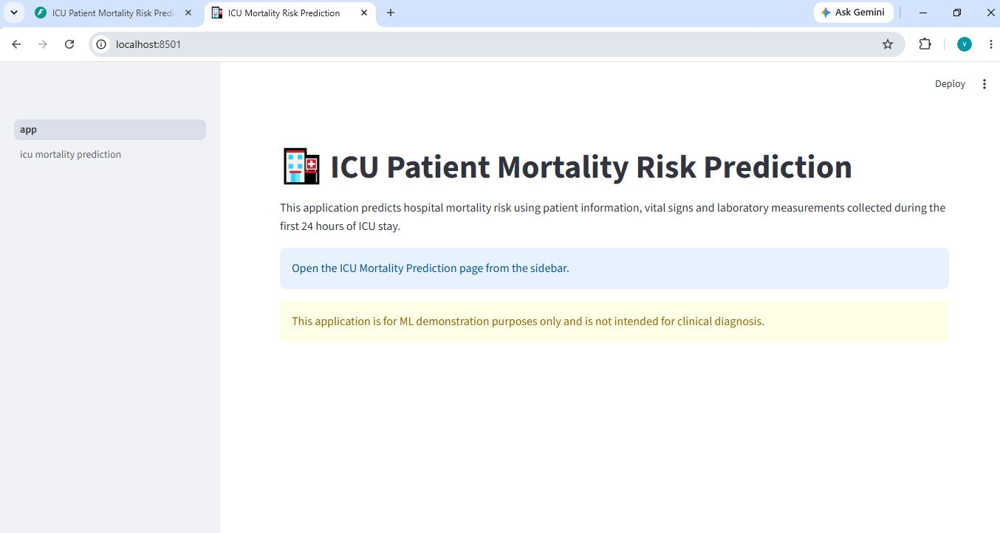
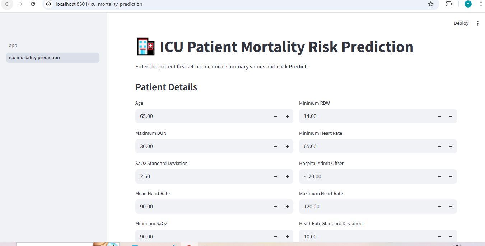
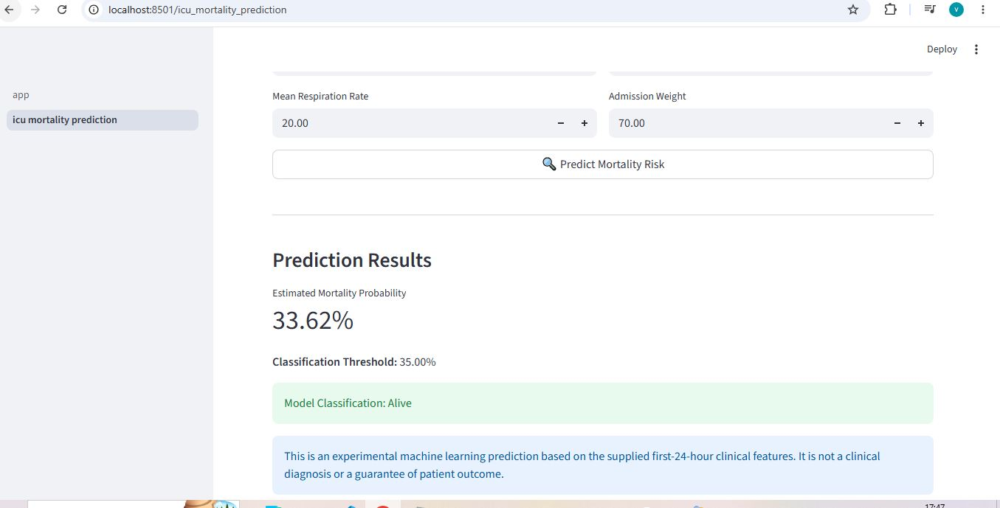
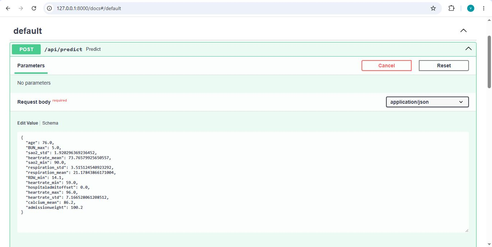
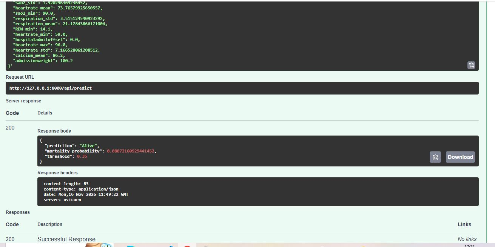
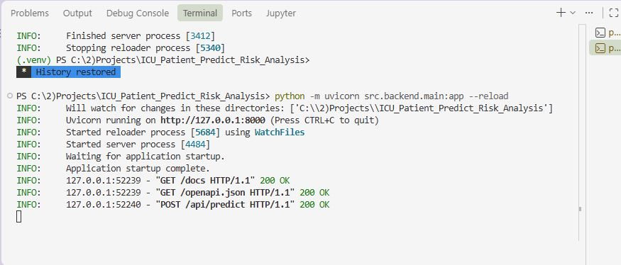

# ICU Patient Mortality Prediction

An end-to-end Machine Learning project that predicts ICU patient hospital mortality risk using clinical information collected during the first 24 hours of an ICU stay.

**Technology Stack:** Python, Pandas, NumPy, Scikit-learn, XGBoost, FastAPI and Streamlit.

## 1. Project Overview

The objective of this project is to develop a machine learning system that estimates the probability of hospital mortality using patient demographics, vital signs and laboratory measurements collected during the first 24 hours of ICU admission.

The trained model is integrated into an interactive prediction application using FastAPI as the backend and Streamlit as the frontend.

### Key Components

- Clinical data analysis and exploratory data analysis
- Data cleaning and preprocessing
- First 24-hour clinical feature engineering
- Patient-level feature aggregation
- Machine learning model training and evaluation
- Prediction API using FastAPI
- Interactive prediction interface using Streamlit

## 2. Business Problem

ICU patients require continuous monitoring because their clinical conditions can change rapidly.

The objective of this project is to explore whether clinical information available during the first 24 hours of ICU admission can help estimate the probability of hospital mortality.

This project demonstrates the application of machine learning to a healthcare prediction problem.

## 3. Dataset Description

**Dataset:** eICU Collaborative Research Database (eICU-CRD)

Three datasets were used:

| Dataset | Description |
|---|---|
| `patient.csv` | Patient demographics and hospital outcome information |
| `vitalPeriodic.csv` | Periodic vital sign measurements |
| `lab.csv` | Laboratory measurements |

The datasets were analyzed and integrated to construct patient-level features using the first 24-hour observation window.

### Target Variable

Target column: `hospitaldischargestatus`

- Alive = 0
- Expired = 1

**Dataset availability:** The original eICU datasets are not included in this repository. Users must obtain authorized access through the official eICU-CRD source and comply with its data-use requirements.

## 4. Machine Learning Workflow

The project follows an end-to-end machine learning workflow.

1. Business problem understanding
2. Patient dataset exploratory data analysis
3. Vital signs exploratory data analysis
4. Laboratory data exploratory data analysis
5. Data cleaning and preprocessing
6. First 24-hour time-window preparation
7. Clinical feature extraction and aggregation
8. Dataset integration
9. Feature engineering
10. Model training
11. Model evaluation
12. Deployment model preparation

## 5. Project Architecture

The application follows a frontend-backend architecture.

```text
                 User
                   |
                   v
           Streamlit Frontend
                   |
                   | HTTP POST Request
                   v
             FastAPI Backend
                   |
                   v
             Prediction Service
                   |
                   v
             Deployment Model
                   |
                   v
          Mortality Probability
                   |
                   v
          Predicted Classification
                   |
                   v
           Streamlit Result
```

### Technology Stack

| Component | Technology |
|---|---|
| Programming Language | Python |
| Data Processing | Pandas, NumPy |
| Visualization | Matplotlib, Seaborn |
| Machine Learning | Scikit-learn, XGBoost |
| Backend | FastAPI |
| Frontend | Streamlit |
| API Communication | Requests |
| Model Serialization | Pickle |

## 6. Repository Structure

```text
ICU_Patient_Predict_Risk_Analysis/
│
├── src/
│   ├── backend/
│   │   ├── main.py
│   │   ├── api/
│   │   ├── config/
│   │   ├── schemas/
│   │   └── services/
│   │
│   ├── frontend/
│   │   ├── app.py
│   │   ├── config/
│   │   └── pages/
│   │
│   └── training/
│
├── notebooks_dir/
│   ├── 01_patient_eda.ipynb
│   ├── 02_vitalPeriodic_eda.ipynb
│   ├── 03_lab_eda.ipynb
│   ├── 04.PreProcessing.ipynb
│   ├── 05_model_training.ipynb
│   ├── 06_model_evaluation.ipynb
│   └── 07_deployement_model.ipynb
│
├── model_dir/
│   └── deployment_icu_mortality_model.pkl
│
├── screenshots/
│   ├── frontend_streamlit/
│   │   ├── Screenshot1.JPG
│   │   ├── Screenshot2.JPG
│   │   └── Screenshot3.JPG
│   │
│   └── swaggerDocs/
│       ├── firstscreenshot.JPG
│       ├── Secondscreenshot.JPG
│       └── Thirdscreenshot.JPG
│
├── tests/
│   ├── __init__.py
│   ├── test_backend_settings.py
│   ├── test_predict.py
│   ├── test_prediction_schema.py
│   └── test_settings.py
│
├── requirements.txt
├── .gitignore
└── README.md
```

## 7. Application Screenshots

### 7.1 Streamlit Frontend

The Streamlit interface allows users to enter the required clinical features and request a mortality risk prediction.







### 7.2 FastAPI Backend – Swagger Documentation

The FastAPI backend exposes the prediction endpoint and provides interactive API documentation through Swagger UI.







## 8. Model Prediction

The deployment model returns:

- Estimated mortality probability
- Configured classification threshold
- Predicted classification

The classification threshold determines how the estimated probability is converted into a predicted class.

The prediction is an experimental machine learning output. It is not a clinical diagnosis or a guarantee of patient outcome.

## 9. Installation and Setup

### Step 1: Clone the Repository

```bash
git clone <YOUR_GITHUB_REPOSITORY_URL>
cd ICU-Patient-Mortality-Prediction
```

### Step 2: Create a Virtual Environment

```bash
python -m venv .venv
```

Activate the environment on Windows:

```powershell
.venv\Scripts\activate
```

### Step 3: Install Dependencies

```bash
pip install -r requirements.txt
```

### Step 4: Configure Environment Variables

Create a local `.env` file containing the configuration variables required by the application.

Refer to the project configuration settings. Do not upload credentials, API keys or other secrets to GitHub.

### Step 5: Run the Application

Start the FastAPI backend and Streamlit frontend using their respective application entry points and configuration.

## 10. Limitations

- Model predictions depend on the quality and availability of clinical input measurements.
- The model is intended for machine learning demonstration and educational purposes.
- The model has not been established as a clinically validated decision-support system.
- Predictions should not replace professional medical judgment.

## 11. Acknowledgements

This project uses the eICU Collaborative Research Database (eICU-CRD).

Please refer to the official dataset documentation and access requirements before using the dataset.

---

**Disclaimer:** This project is for educational and machine learning demonstration purposes only. It is not intended for clinical diagnosis, treatment recommendations or real-world medical decision-making.